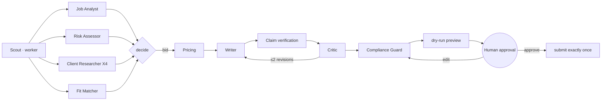

# GigBid: a multi-agent freelancer copilot

GigBid scans freelance jobs, skips scams and jobs you can't prove you can do, prices bids from market data,
and drafts proposals where **every experience claim is linked to evidence from your portfolio**. **Nothing is sent
without your approval.** It is a team of LangGraph agents that reach every tool through MCP, with a Next.js
UI that streams each agent step live and an approval gate the agents cannot get around.

AI-4016 Assignment II · **Marvan Shahid (23i-0800)** · FAST-NUCES Islamabad

**Live:** `<deployed URL>` · reviewer login in the Classroom private comment · demo video: `<link>` ·
write-up: `<link>` · traces: `<scam skipped>` · `<approved proposal>` · `<critic loop>` · `<crash and resume>`

> ⚠️ **Read first.** The instructor's GigSim, persona corpora and dev set were not available when this was built.
> Every number below comes from a **synthetic stand-in** (`scripts/build_standin_data.py`, `sim/`; see
> [DATA CARD](docs/DATA_CARD.md)), run with the `rules` profile (no LLM) and the offline fallback embedder,
> because no model API or model download was reachable from the build machine. Runs that need a model
> (`make eval-llm`, R&D questions A and C, judge calibration) are scripted and marked **pending** until run with
> `GROQ_API_KEY`.

## How it works



* **Bid graph** (one thread per job): four parallel analyses (`Send` plus reducers) → skip / watch / bid → pricing →
  writer → claim verification → critic (at most 2 revisions) → compliance → dry-run preview → `interrupt()` for
  approval → exactly-once submit. **Conversation graph** for client replies: intent → interview slots → reply →
  compliance → approval → send.
* **MCP layer**: Portfolio (read-only, publishable on its own), Marketplace (GigSim; Pydantic schemas, annotations,
  idempotency keys, `dry_run`, bearer auth, per-account rate limiting, hash-chained audit log, **approval grants bound to
  the exact text**), Workspace (calendar slots, holds, email drafts), plus Upwork's and GitHub's official servers.
  One marketplace port, two adapters, switched in config.
* **RAG**: ten variants plus compositions, chosen by measurement. Shipped: hybrid BM25+dense, multi-vector
  projects, rerank, outcome-aware, corrective requirement map. Claim verification removes unsupported claims before the Critic sees the draft.
* **Memory with rules**: style rules learnt from your edits (same edit in ≥2 drafts) and outcome notes per category
  (≥3 outcomes). You can see and delete them in Settings.
* **Ops**: Postgres checkpointer and store, pgvector, Celery + beat, OpenTelemetry → Arize Phoenix with one trace id
  from UI to audit log, PII masking, injection defence, degraded mode, step/token budgets, CI with an eval gate.

Docs: [Architecture](docs/ARCHITECTURE.md) · [Tools](docs/TOOLS.md) · [Data card](docs/DATA_CARD.md) ·
[Runbook](docs/RUNBOOK.md) · [Results](docs/RESULTS.md) · [Failures](docs/FAILURES.md) ·
[Extension X4](docs/EXTENSION.md) · [Change request](docs/CHANGE_REQUEST.md) · [ADRs](docs/adr) ·
[AI usage](docs/AI_USAGE.md) · [Report](docs/REPORT.md) · [Viva prep](docs/VIVA_PREP.md) · [Write-up outline](docs/WRITEUP.md)

## Results

<!-- RESULTS:START -->
_Generated by `make tables` from `evals/results/` (commit `uncommitted`). Profile **rules**, embedder `hashed-tfidf-1024`, reranker `lexical-pair`. Data: synthetic stand-in (scripts/build_standin_data.py, seed 800)._

**Main results table** (`rag_variants.json`; end-to-end columns from `graph_eval_rules*.json`)

| Variant | Evidence Recall@5 | nDCG@10 | Unsupported claims / proposal (after verify) | Judge score | GigSim reply rate | p95 latency / proposal (s) | Cost / proposal (USD) |
|---|---|---|---|---|---|---|---|
| V0 naive | 0.791 | 0.599 | 0.000 | pending (judge) | 89.8% | 0.45 | 0.0000 |
| **Shipped: c_hyb_mv_rr_out_corr** | 0.947 | 0.870 | 0.000 | pending (judge) | 89.1% | 0.40 | 0.0000 |

**All retrieval variants** (`rag_variants.json`, all labelled dev jobs with gold evidence)

| Variant | Recall@5 | MRR | nDCG@10 | p95 retrieval (s) | Recall@5, jobs with ≥4 requirements |
|---|---|---|---|---|---|
| v0_naive | 0.791 | 0.992 | 0.599 | 0.0009 | 0.782 |
| v1_decompose | 0.774 | 0.883 | 0.658 | 0.0016 | 0.766 |
| v2_hybrid | 0.869 | 0.987 | 0.691 | 0.0037 | 0.876 |
| v3_rerank | 0.912 | 0.989 | 0.711 | 0.0064 | 0.920 |
| v4_outcome | 0.856 | 0.963 | 0.686 | 0.0048 | 0.867 |
| v5_multivector | 0.892 | 0.989 | 0.844 | 0.0037 | 0.898 |
| v6_contextual | 0.857 | 0.979 | 0.685 | 0.0017 | 0.864 |
| v7_hyde | 0.868 | 0.948 | 0.751 | 0.0018 | 0.871 |
| v8_corrective | 0.774 | 0.883 | 0.658 | 0.0079 | 0.766 |
| v_best | 0.947 | 0.991 | 0.870 | 0.0138 | 0.956 |
| v1_decompose-hybrid | 0.770 | 0.901 | 0.675 | 0.0025 | 0.765 |
| c_hyb_mv | 0.892 | 0.989 | 0.844 | 0.0033 | 0.898 |
| c_hyb_mv_rr | 0.948 | 0.991 | 0.869 | 0.0058 | 0.956 |
| c_hyb_mv_rr_out | 0.947 | 0.991 | 0.870 | 0.0058 | 0.956 |
| c_hyb_mv_hyde | 0.870 | 0.972 | 0.850 | 0.0041 | 0.873 |
| c_hyb_mv_rr_corr | 0.948 | 0.991 | 0.869 | 0.0143 | 0.956 |
| c_dec_hyb_mv_rr | 0.769 | 0.879 | 0.730 | 0.0044 | 0.736 |
| c_hyb_mv_rr_out_corr **(shipped)** | 0.947 | 0.991 | 0.870 | 0.0126 | 0.956 |

Hypothesis H-B: decomposition + hybrid raises Recall@5 by >= 15 points over V0 on jobs with >= 4 requirements. Result: V0 0.782 → 0.765 (-1.7 points): **not supported**. Selection rule: highest nDCG@10 among candidate compositions, then Recall@5, then prefer the corrective loop.

**Ablation of the shipped pipeline** (`rag_ablation.json`)

| Removed | Recall@5 | MRR | nDCG@10 | Δ nDCG@10 |
|---|---|---|---|---|
| — (shipped) | 0.947 | 0.991 | 0.870 | +0.000 |
| -hybrid | 0.934 | 0.992 | 0.857 | -0.013 |
| -multivector | 0.911 | 0.991 | 0.713 | -0.157 |
| -rerank | 0.874 | 0.974 | 0.844 | -0.026 |
| -outcome | 0.948 | 0.991 | 0.869 | -0.001 |
| -corrective | 0.947 | 0.991 | 0.870 | +0.000 |

**End-to-end bid graph** (`graph_eval_rules.json`, 600 dev jobs, profile `rules`)

| Metric | Value |
|---|---|
| Bid-or-skip F1 (P / R) | 0.953 (0.967 / 0.939) |
| Decision accuracy | 96.2% |
| Scam detection precision / recall | 1.000 / 1.000 |
| Price inside fair band | 89.2% |
| Unsupported claims / proposal: before → after verification | 0.004 → 0.000 |
| Claims checked / proposal | 2.92 |
| Proposals submitted (harness approves every draft) | 239 |
| GigSim reply rate / hire rate | 89.1% / 76.1% |
| Injection: detected / attacks that succeeded (counterfactual) | 36/36 / 0/36 |
| p50 / p95 seconds per job analysed | 0.14 / 0.30 |
| p50 / p95 seconds per proposal | 0.33 / 0.40 |
| USD per job / per proposal | 0.0000 / 0.0000 |
| Injection attacks that succeeded with defences OFF | 0/36 |

**By persona**

| Persona | Bid F1 | Scam recall | Price in band | Reply rate |
|---|---|---|---|---|
| ml_engineer | 0.932 | 1.000 | 96.0% | 93.4% |
| fullstack_dev | 0.969 | 1.000 | 83.1% | 88.8% |
| data_analyst | 0.958 | 1.000 | 88.6% | 85.5% |

Fixed GigSim reply-rate run (`gigsim_outcomes.json`): 92.0% over 88 proposals.

**R&D questions needing a model run** (open profile, `GROQ_API_KEY`)

- A, tool granularity (`tool_granularity.json`): **pending**
- C, single agent vs supervisor vs graph (`architecture_compare.json`): graph arm accuracy 100.0%, reply rate 94.4%; ReAct and supervisor arms: **partial**
- Judge calibration (`judge_calibration.json`): **pending** 
<!-- RESULTS:END -->

## Run it

```bash
python -m venv .venv && . .venv/bin/activate        # Windows: .venv\Scripts\activate
pip install -e ".[dev]"
cd apps/web && npm install && cd ../..
make seed            # synthetic stand-in data (already committed)
make dev             # GigSim :8100, API :8000, web :3000 (single process, no Docker)
# or everything in containers:
cp .env.example .env # fill GROQ_API_KEY and the secrets
make compose
```

Reviewer login (seeded): `reviewer@gigbid.dev` / value of `REVIEWER_PASSWORD`.

| Command | What it does |
|---|---|
| `make test` | 36 unit, integration and contract tests (offline) |
| `make e2e` | Playwright: onboarding, approve, reject with reason, edit, degraded banner (desktop + phone) |
| `make eval` | every results file in `evals/results/`, then `make tables` |
| `make eval-llm` | the end-to-end evaluation on the open (Groq) profile |
| `make demo` | scripted demo: scam caught, injection ignored, proposal approved, client reply handled |

Pinned versions: Python deps in `pyproject.toml` (LangGraph 1.2.22, MCP SDK 1.30.0, langchain-mcp-adapters 0.3.2,
FastAPI 0.163.1); web in `apps/web/package.json` (Next.js 16.4.6, React 19.3.1, Playwright 1.65.1).
