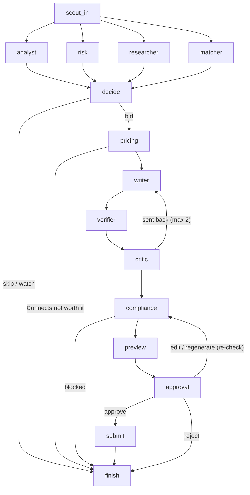

# Architecture

```
Next.js UI ──SSE/REST──> FastAPI ──> Celery worker (Redis) ──> LangGraph bid / conversation graphs
                              │                                     │ (Postgres checkpointer, LangGraph store)
                              │                                     ▼
                              │                       agent/mcp_client.py  (allowlists, timeouts, retries, degraded mode)
                              │                     ┌───────────────┼──────────────────┬──────────────────┐
                              ▼                     ▼               ▼                  ▼                  ▼
                       approvals (mint       Portfolio MCP   Marketplace MCP     Workspace MCP     Upwork MCP (OAuth 2.1)
                       one-time grant)       (read-only,     (GigSim adapter,    (calendar slots,  + GitHub MCP
                                              RAG + pgvector) grants, audit)      email drafts)     (third-party)
```

## The two graphs (rendered from code: `python scripts/render_graphs.py` → `docs/images/*.mmd`)

**Bid graph**, one thread per job (`agent/graphs/bid_graph.py`):



* `analyst`, `risk`, `researcher` and `matcher` run **in parallel** (one `Send` each). They write
  different keys of `analyses`, merged by the `merge_dicts` reducer, so there are no write conflicts.
* `approval` calls `interrupt()`. The thread is checkpointed in Postgres and resumes from the UI.
* `submit` uses an idempotency key derived from (account, job, draft), so a crash after the marketplace
  accepted the proposal is replayed rather than submitted twice (tested in `tests/integration/test_durability.py`).

**Conversation graph**, one thread per client conversation: `read_thread → intent → (slots) → draft_reply →
reply_compliance → approve_reply (interrupt) → send`.

## Why each agent exists

| Agent | Why it is separate | Model (open profile) | Tools (allowlist) |
|---|---|---|---|
| Scout (worker) | Runs on a schedule, outside any request; de-duplicates by id and content hash | none | search_jobs, get_job |
| Job Analyst | Turns untrusted text into a typed JobSpec that later steps can decide on | small | none |
| Risk Assessor | Rules first (cheap, explainable), model second; needs client history | small | get_client_history |
| Client Researcher (X4) | Builds a client brief that both the decision and the writer use | small | get_client_history, market_stats |
| Fit Matcher | Requirement → evidence matrix; runs the shipped RAG pipeline through the Portfolio server | none | retrieve_for_job, search_evidence |
| Pricing Strategist | Market percentiles + client spend + floor + policy-aware Connects cost | none | market_stats, get_connects_* |
| Proposal Writer | The only node that writes prose; strongest model | large | search_evidence, get_case_study |
| Claim verification | Separate from the writer, so the writer does not grade itself | small (optional) | — (evidence in state) |
| Critic | Bounded revision loop (max 2) on grounding, personalisation, length, coverage | large | search_evidence |
| Compliance Guard | Deterministic policy rules from `data/policy_pack/rules.yaml`; can block | none | none |
| Client Liaison | Different job (dialogue, scheduling), different graph and thread | large | list_messages, send_message, free_slots, … |

## State, execution trace and long-term memory are kept apart

* **State** (`agent/state.py`): what this job needs now: job, analyses, evidence, decision, price, drafts,
  critiques, approvals and the submission, plus step/token counters for the budgets.
* **Execution trace**: every node, model call (tokens, cost) and MCP tool call (arguments, result) is an
  OpenTelemetry span (`agent/observability.py`), exported to Arize Phoenix and to `data/processed/traces/`, and every
  marketplace/workspace call is also in the hash-chained audit log. It is not stored in graph state.
* **Long-term memory** (`agent/memory/`): a LangGraph store with two promoted namespaces, `style` and `outcome`,
  written only by `promotion_rules.py` (RULE S: the same edit pattern in ≥2 different drafts; RULE O: ≥3 outcomes in a
  category). Candidates live in a separate namespace the writer never reads. The Settings screen lists everything
  and can delete any item. A deleted style rule is blocked from being promoted again.

## One marketplace port (R1)

`agent/marketplace_port.py` defines `MarketplacePort`. `GigSimPort` calls GigBid's own Marketplace MCP server.
`UpworkPort` calls Upwork's official MCP server through `MultiServerMCPClient` with the SDK's OAuth provider and
encrypted per-user token storage. The method → Upwork tool mapping is in `upwork_tools.yaml`. `marketplace.mode`
in `agent/config.yaml` selects one. No code under `agent/graphs` or `agent/nodes` changes between modes.

## The human gate cannot be bypassed

Write tools refuse without an **approval grant**: a short-lived JWT the API mints only when the user approves in the
UI. It binds the account, the action, the SHA-256 of the exact payload, and a one-time id. Editing after approval
changes the hash, so the grant no longer matches. A second use of the grant is refused. An agent that calls
`submit_proposal` directly, without the UI, gets `[approval_required]`.
